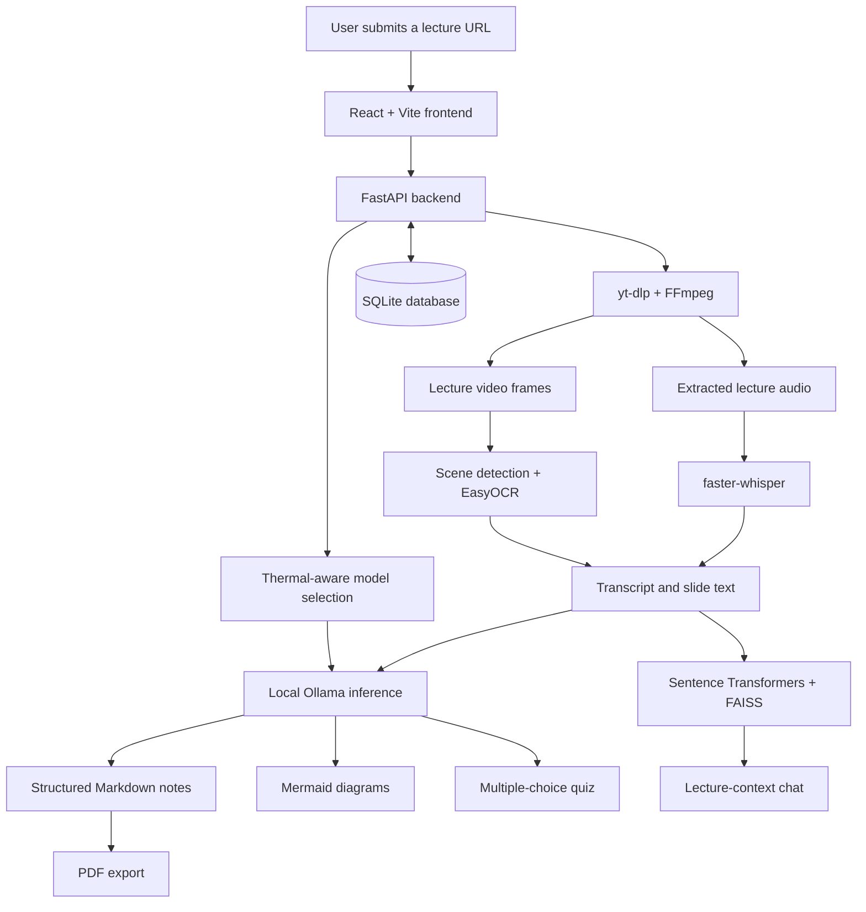

# CogniLecture

**An AI-powered multimodal learning intelligence system** that transforms
educational lecture videos into structured, study-ready materials.

CogniLecture combines speech transcription, slide-text extraction, local
LLM generation, retrieval-augmented chat, quizzes, and PDF export in a
React web interface backed by FastAPI.

## Features

- **Lecture ingestion:** Submit a YouTube lecture URL for processing using
  `yt-dlp` and FFmpeg.
- **Speech transcription:** Transcribe lecture audio locally with
  `faster-whisper`.
- **Slide-text extraction:** Detect video scenes and extract visible text
  using PySceneDetect and EasyOCR.
- **Structured study notes:** Generate organized Markdown notes from
  transcript and extracted slide text using a local Ollama model.
- **Diagrams:** Generate Mermaid flowcharts when the lecture content
  contains a suitable process, workflow, or hierarchy.
- **Practice quizzes:** Generate multiple-choice questions and regenerate
  a quiz at a selected difficulty.
- **Lecture chat:** Ask follow-up questions using transcript retrieval
  with Sentence Transformers and FAISS.
- **Charts:** When the lecture states numeric data, a chart is added to the notes.
- **Processing status:** Each lecture shows Queued, Processing (with the current stage), Ready, or Failed (with the error).
- **PDF export:** Export generated lecture notes to PDF (diagrams are not included in the PDF).
- **Local persistence:** Store lecture and generated-content records in
  SQLite.
- **Thermal-aware model selection:** The thermal agent chooses between
  configured Ollama models using its current estimated thermal state.
  The displayed temperature is an estimate, not a hardware sensor reading.

## System Architecture



## Project Structure

```text
cognilecture/
├── .gitignore
├── README.md
├── backend/
│   ├── .env.example
│   ├── config.py
│   ├── database.py
│   ├── main.py
│   ├── scripts/
│   │   └── preload_models.py
│   ├── models/
│   │   ├── __init__.py
│   │   └── models.py
│   ├── requirements.txt
│   └── services/
│       ├── __init__.py
│       ├── charts.py
│       ├── cleaner.py
│       ├── export.py
│       ├── ingestion.py
│       ├── llm.py
│       ├── ocr.py
│       ├── rag.py
│       ├── thermal_agent.py
│       └── transcription.py
└── frontend/
    ├── .env.example
    ├── .gitignore
    ├── .oxlintrc.json
    ├── README.md
    ├── index.html
    ├── package-lock.json
    ├── package.json
    ├── public/
    │   ├── favicon.svg
    │   └── icons.svg
    ├── scripts/
    │   └── capture_screenshots.js
    ├── src/
    │   ├── App.jsx
    │   ├── api/
    │   │   └── client.js
    │   ├── components/
    │   │   ├── ChatWidget.jsx
    │   │   ├── MarkdownRenderer.jsx
    │   │   ├── layout/
    │   │   │   ├── AppShell.jsx
    │   │   │   ├── PageHeader.jsx
    │   │   │   └── SectionHeader.jsx
    │   │   ├── lectures/
    │   │   │   ├── LectureCard.jsx
    │   │   │   ├── LectureList.jsx
    │   │   │   └── VideoSubmitForm.jsx
    │   │   ├── telemetry/
    │   │   │   └── ThermalGovernor.jsx
    │   │   └── ui/
    │   │       ├── Badge.jsx
    │   │       ├── Button.jsx
    │   │       ├── Card.jsx
    │   │       ├── EmptyState.jsx
    │   │       ├── MetricChip.jsx
    │   │       ├── Modal.jsx
    │   │       ├── ProgressBar.jsx
    │   │       ├── Skeleton.jsx
    │   │       └── Spinner.jsx
    │   ├── context/
    │   │   └── ToastContext.jsx
    │   ├── hooks/
    │   │   ├── useTelemetry.js
    │   │   └── useToast.js
    │   ├── index.css
    │   ├── main.jsx
    │   └── pages/
    │       ├── Dashboard.jsx
    │       ├── LectureView.jsx
    │       └── QuizView.jsx
    ├── tailwind.config.js
    └── vite.config.js
```

## Requirements

- Python 3.11
- Node.js 22 or later and npm
- FFmpeg
- Pandoc for PDF export
- [Ollama](https://ollama.com/) for local LLM inference

Some machine-learning models may need to be downloaded on first use.
You also need internet access for YouTube ingestion and model downloads.

## Installation and Setup

### 1. Clone the repository

```bash
git clone https://github.com/Sameer-Kazmi/cognilecture.git
cd cognilecture
```

### 2. Create local environment files

From the repository root:

```bash
cp backend/.env.example backend/.env
cp frontend/.env.example frontend/.env
```

Edit these files if you need to customize your configuration. Do not
commit private `.env` files.

### 3. Download the Ollama models

```bash
ollama pull qwen2.5:3b
ollama pull qwen2.5:0.5b-instruct
```

Ensure Ollama is running on its default port, `11434`. If it is not
already running, start the service in a terminal:

```bash
ollama serve
```

Keep the service running while using CogniLecture. If Ollama is already
running as a service or application, do not start a second instance.

### 4. Install and start the backend

Open a terminal in the repository root:

```bash
cd backend
python3.11 -m venv venv
source venv/bin/activate
python -m pip install --upgrade pip
pip install -r requirements.txt
python scripts/preload_models.py   # optional: download Whisper, EasyOCR and embedding models now
python -m uvicorn main:app --reload --port 8000
```

The backend runs at `http://localhost:8000`.

- Interactive API documentation: `http://localhost:8000/docs`
- OpenAPI specification: `http://localhost:8000/openapi.json`
- Health check: `http://localhost:8000/health` (also reports whether Ollama and both models are available)
- The SQLite database is created at `backend/data/cognilecture.db`, whichever folder you start the server from.

### 5. Install and start the frontend

Open another terminal in the repository root:

```bash
cd frontend
npm install
npm run dev
```

Open `http://localhost:5173` in your browser.

## Environment Variables

| Variable | File | Default | Purpose |
|---|---|---|---|
| `OLLAMA_BASE_URL` | `backend/.env` | `http://localhost:11434/v1` | OpenAI-compatible Ollama API base URL |
| `OLLAMA_CHAT_URL` | `backend/.env` | `http://localhost:11434/api/chat` | Native Ollama chat endpoint |
| `OLLAMA_API_KEY` | `backend/.env` | `ollama` | Local API-client compatibility value |
| `OLLAMA_MODEL` | `backend/.env` | `qwen2.5:3b` | Primary language model |
| `OLLAMA_COMPACT_MODEL` | `backend/.env` | `qwen2.5:0.5b-instruct` | Compact language model |
| `WHISPER_MODEL` | `backend/.env` | `base` | Speech-recognition model size |
| `WHISPER_CPU_THREADS` | `backend/.env` | CPU core count | Threads used by Whisper |
| `OCR_MAX_SLIDES` | `backend/.env` | `6` | Maximum slides sampled for OCR |
| `MAX_PROMPT_CHARS` | `backend/.env` | `36000` | Prompt budget; longer lectures are processed in parts |
| `VITE_API_BASE_URL` | `frontend/.env` | `http://localhost:8000` | Backend URL used by the frontend |

Change the relevant `.env` value and restart the corresponding service
after modifying configuration.

## API Endpoints

This table reflects the routes exposed by the current FastAPI application.
See `/docs` or `/openapi.json` for request and response schemas.

| Method | Endpoint | Description |
|---|---|---|
| POST | `/analyze` | Submit a lecture for analysis |
| POST | `/chat` | Chat with lecture content |
| GET | `/health` | Check API health |
| GET | `/lectures` | List stored lectures |
| GET | `/lectures/{lecture_id}` | Lecture status, stage and error |
| GET | `/lectures/{lecture_id}/export` | Export lecture notes as PDF |
| GET | `/lectures/{lecture_id}/notes` | Retrieve lecture notes |
| GET | `/lectures/{lecture_id}/quiz` | Retrieve the lecture quiz |
| POST | `/lectures/{lecture_id}/quiz/regenerate` | Regenerate a quiz at a selected difficulty |
| GET | `/system/thermal` | Retrieve thermal telemetry and model-selection state |
| POST | `/system/thermal/physical-stress` | Toggle a CPU stress workload |
| POST | `/system/thermal/simulate-spike` | Toggle a simulated thermal spike |

## Known Limitations

- **Estimated temperature:** Thermal readings are estimated from a baseline,
  CPU load, and simulation logic. The endpoint does not currently read
  actual laptop CPU temperature sensors. Even when a CPU stress workload
  runs, the displayed temperature remains an estimate.
- **PDF export:** Needs Pandoc and Chrome, Edge or Brave installed. Mermaid diagrams are not rendered into the PDF.
- **Long lectures:** Notes are written in parts when a transcript exceeds the prompt budget; quiz, diagram and chart use the notes in that case.
- **Generation time:** Processing time depends on lecture length, hardware,
  and the selected local model.
- **Generated-content accuracy:** Transcriptions, extracted slide text,
  notes, diagrams, and quizzes can contain errors and should be reviewed.
- **OCR quality:** Slide-text extraction depends on video quality, contrast,
  scene changes, and text visibility.
- **Network access:** YouTube ingestion and first-time model downloads
  require internet access. LLM inference is configured for local Ollama.
- **Local persistence:** Lecture data is stored in SQLite. User accounts
  and authentication are not currently implemented.
- **Model availability:** Pull both configured Ollama models before use.
  Fallback behavior can affect which model the thermal agent selects.

## License

A license file is not currently included in the tracked repository.
Add one before distributing the project with specific license terms.
